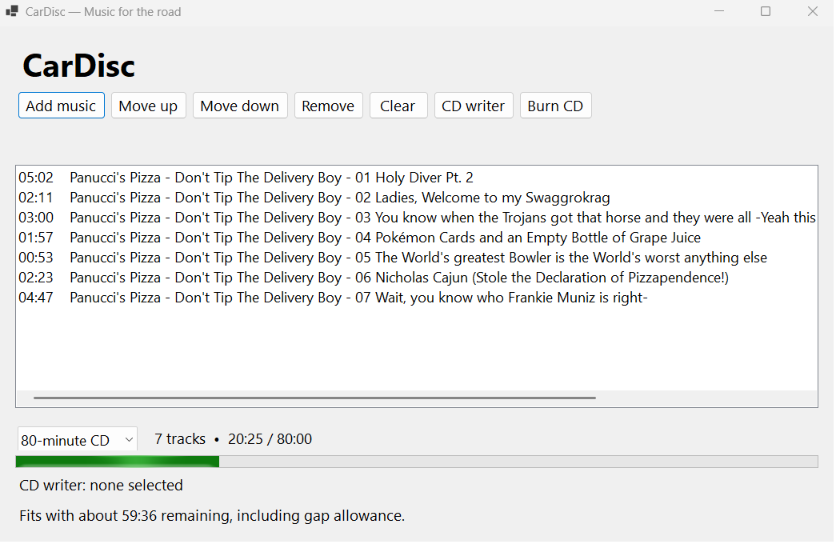

# CarDisc
A Windows desktop app for creating audio CDs, with track ordering, capacity checks, and CD burning. Built with C# and .NET 8.


## Screenshot




## Future Updates
Possibly some sort of push to take list of songs written to CD to screenshot or txt file or printout of some kind that could be put on CD case.

More specifically I think the best option would be some sort of .txt file generated and then from that you can take that .txt file to an optional printout that could be based on default cd case size.


## Setup and running locally

### Requirements

- Windows 10 or Windows 11.
- [.NET 8 SDK](https://dotnet.microsoft.com/download/dotnet/8.0). For most Intel or AMD computers, choose **SDK → Windows x64**. Install the SDK, not just the runtime.
- [Git](https://git-scm.com/downloads/win) to clone the repository.
- Optional: [Visual Studio Code](https://code.visualstudio.com/) to edit the source.
- To burn discs: a CD writer and blank CDs. **CD-R** is recommended for car stereos.

After installing Git and .NET, restart your terminal or VS Code.

### Clone the repository

Open PowerShell and run:

```powershell
git clone https://github.com/JoelTul/CarDisc.git
cd CarDisc
```

### Run the app

Find the project file and run it:

```powershell
$project = Get-ChildItem -Recurse -Filter CarDisc.csproj |
    Select-Object -First 1

if ($project) {
    dotnet run --project $project.FullName
} else {
    Write-Host "CarDisc.csproj was not found. Open the cloned repository folder."
}
```

The first run downloads the required NuGet packages automatically, so an internet connection is needed.

For subsequent runs, open a terminal in the folder containing `CarDisc.csproj` and use:

```powershell
dotnet run
```

### Burn an audio CD

1. Connect your CD writer.
2. Open CarDisc and add local music files.
3. Arrange the tracks and check the disc-capacity meter.
4. Select your CD writer.
5. Insert a blank CD-R and click **Burn CD**.
6. Keep the computer awake and the drive connected until burning and finalization finish.

Allow about **1 GB of free temporary storage** for a full disc. Audio format support depends on the Windows codecs installed.

### Build a standalone Windows app

From the folder containing `CarDisc.csproj`, run:

```powershell
dotnet publish -c Release -r win-x64 --self-contained true -p:PublishSingleFile=true -p:IncludeNativeLibrariesForSelfExtract=true -o .\release
```

Open `release\CarDisc.exe` to launch the app. This build includes the .NET runtime, so the destination computer does not need the SDK installed.

### Troubleshooting

**`dotnet` is not recognized**

Install the .NET 8 SDK, then close and reopen your terminal. If it is already installed in the default location, try:

```powershell
$env:Path = "C:\Program Files\dotnet;$env:Path"
dotnet --version
```

**Couldn't find a project to run**

You are probably in the repository's outer folder. Locate the project:

```powershell
Get-ChildItem -Recurse -Filter *.csproj |
    Select-Object FullName
```

Then run it using the displayed path:

```powershell
dotnet run --project "PASTE_THE_FULL_CSPROJ_PATH_HERE"
```

**No CD writer appears**

Check that the drive is connected and supports writing CDs, then select **CD writer** again.

**Burn failed**

Record the full error message, including **Failed during** and the hexadecimal error code. If track writing had started, use a fresh blank CD for the next attempt.